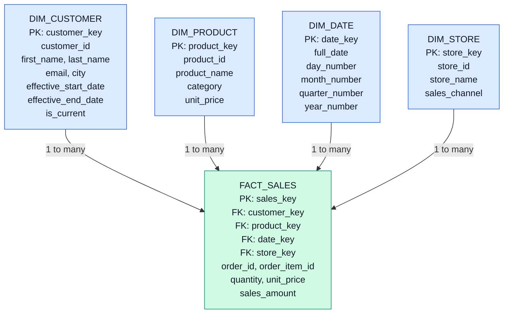

# E-Commerce Data Warehouse — Star Schema ERD

**Database:** `ecommerce_warehouse`  
**Schema type:** Star schema  
**Fact grain:** One row per product line within a sales transaction

## 1. Star Schema Diagram

## 2. Table Relationships

| Dimension table | Primary key | Foreign key in fact_sales |
|---|---|---|
| dim_customer | customer_key | customer_key |
| dim_product | product_key | product_key |
| dim_date | date_key | date_key |
| dim_store | store_key | store_key |

Each dimension row can be associated with multiple sales fact rows. Every sales fact row references one row from each dimension.

## 3. Fact Table Design

**Table:** `fact_sales`

**Measures:**
- `quantity`
- `unit_price`
- `sales_amount`

**Identifiers:**
- `sales_key`: warehouse-generated primary key
- `order_id`: order identifier
- `order_item_id`: line-item identifier

**Grain:** One record represents one product line in an order.

Revenue is calculated as:

`sales_amount = quantity * unit_price`

## 4. Dimension Design

### Customer dimension
Stores customer attributes and historical versions.

- `customer_key`: surrogate primary key
- `customer_id`: source-system identifier
- `first_name`, `last_name`, `email`, `city`
- `effective_start_date`
- `effective_end_date`
- `is_current`

### Product dimension
Stores product names, categories, and unit prices.

### Date dimension
Stores calendar dates and their day, month, quarter, and year attributes.

### Store dimension
Stores store details and sales channels.

## 5. Slowly Changing Dimension Type 2

SCD Type 2 preserves history when a tracked customer attribute changes.

Example:
- Previous version: Priya, Mangaluru
- New version: Priya, Bengaluru

The previous row is retained with `is_current = FALSE`; the new version uses a new `customer_key` and `is_current = TRUE`.

## 6. Design Benefits

- Supports revenue analysis by product, customer, date, and channel.
- Separates numerical facts from descriptive attributes.
- Uses surrogate keys for warehouse dimension records.
- Retains historical customer changes with SCD Type 2.
- Supports flexible reporting with SQL aggregations and joins.
