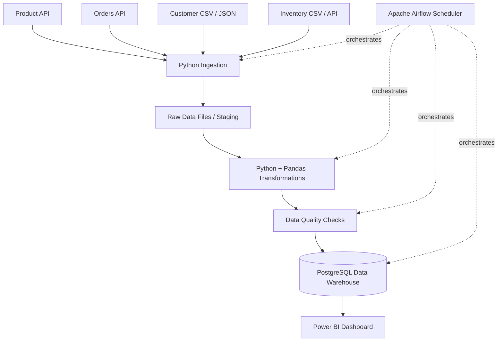

# Solution Architecture

## Architecture overview

## Architecture layers
1. **Sources:** APIs and structured files containing products, customers, orders, order items, and inventory.
2. **Ingestion:** Python collectors retrieve data and preserve raw copies with extraction timestamps.
3. **Staging:** raw data is stored temporarily in files or staging tables.
4. **Transformation:** Pandas/Python standardizes types, names, dates, currencies, and identifiers.
5. **Quality:** required-field, uniqueness, range, and relationship checks are applied.
6. **Warehouse:** PostgreSQL stores dimensions and facts using a star schema.
7. **Orchestration:** Airflow schedules and monitors the workflow.
8. **Consumption:** Power BI connects to curated warehouse tables or views.

## Design decisions
- Begin with daily batch processing to keep the first version manageable.
- Keep raw data separate from transformed and warehouse data.
- Load dimensions before facts to satisfy foreign-key relationships.
- Use stable source/business keys and warehouse surrogate keys.
- Make loads repeatable by defining a deduplication/upsert strategy.
- Store secrets outside source code.

## Deployment assumption
For local development on Windows, PostgreSQL can be installed natively or run in Docker. Apache Airflow is best run in a supported Linux environment such as WSL2 or Docker rather than assumed to run natively on Windows.
