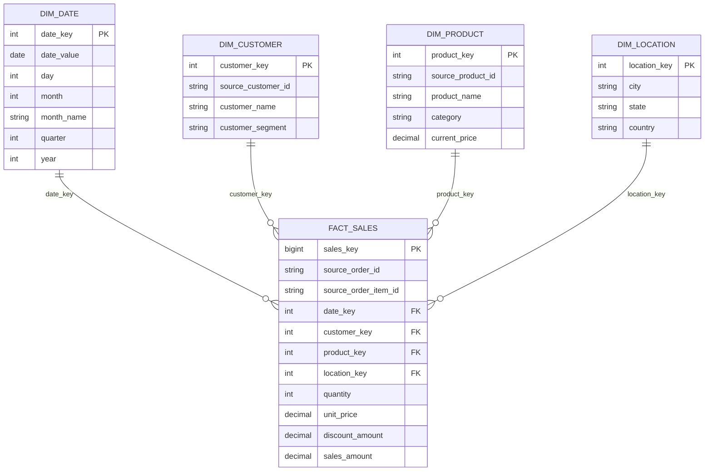

# Data Model — Star Schema

## Grain
One row in `fact_sales` represents one product line within one customer order. If an order contains three products, it contributes three fact rows.

## Entity relationship diagram

## Tables
- `dim_date`: calendar attributes used for time-based analysis.
- `dim_customer`: descriptive customer attributes.
- `dim_product`: product name, category, and price attributes.
- `dim_location`: city/state/country attributes.
- `fact_sales`: measurable sales activity at order-item grain.

## Inventory design note
Inventory is a separate business process and has a different grain: one snapshot per product, location, and snapshot date. A later implementation can add `fact_inventory_snapshot` linked to `dim_product`, `dim_location`, and `dim_date`. Do not mix inventory snapshot quantities into the sales fact table.
