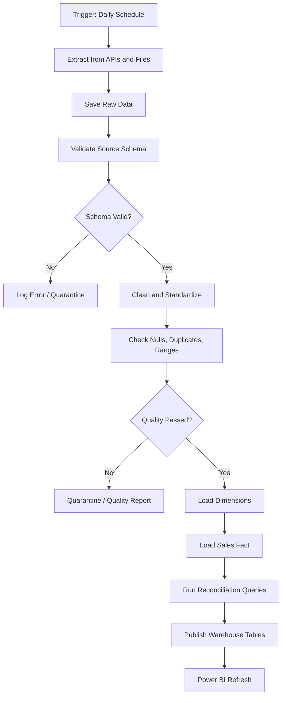

# ETL Flow

## Processing steps
1. Extract source records and record source name, batch ID, and extraction timestamp.
2. Preserve raw source data so processing can be repeated.
3. Validate expected columns and data types.
4. Standardize identifiers, timestamps, category labels, and numeric values.
5. Check required fields, duplicates, positive quantities, non-negative prices, and valid dimension references.
6. Send invalid records to a quarantine location and record rejection reasons.
7. Upsert dimensions using source business keys.
8. Resolve surrogate keys and load fact rows.
9. Reconcile source counts and sales totals with warehouse results.
10. Log completion status and make curated tables available to Power BI.

## Error handling
- Retry transient API/network/database failures with bounded retries.
- Do not silently discard invalid records.
- Log batch ID, task, timestamp, and error details.
- Make loads idempotent so reruns do not duplicate records.
